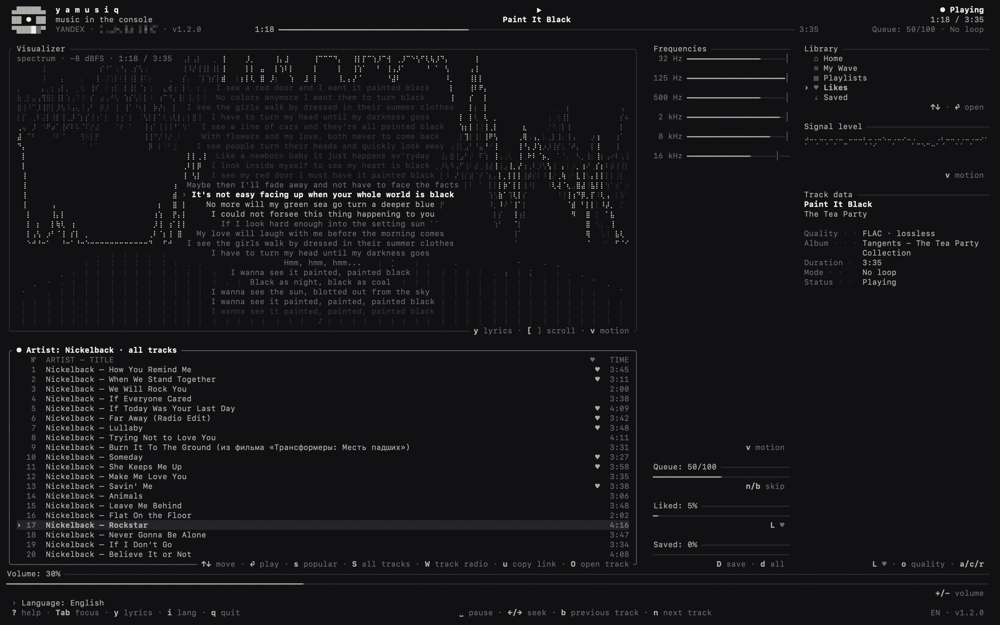

# yamusiq

[Русский](README.md) · **Version 1.2.0**



Keyboard-first Yandex Music terminal client for macOS on Apple Silicon and Intel, built with Rust and ratatui.

## Current status

Fullscreen TUI for your Yandex Music account. It covers search, playlists, My Wave, likes (read / like / unlike), artist views (popular / all tracks), lyrics (synced LRC or plain text) and real playback in a selectable quality up to lossless FLAC. There is no offline demo: on first start yamusiq walks you through signing in.

Code map:

- `src/service.rs` — `MusicService` trait (search, playlists, My Wave, likes, cached, artist tracks, like/unlike, lyrics, stream URL);
- `src/login.rs` — first-run sign-in: instructions, opens the Yandex sign-in page, takes the key or the whole address-bar link without echoing it, verifies it and stores it with mode 600;
- `src/yandex/` — `YandexService` for `api.music.yandex.net`. This is the unofficial API the official apps use. Includes request signing for lyrics and direct stream links;
- `src/player.rs` — `Player` trait (play, pause, seek, analysis) and `SimPlayer`, a clock-only player used when there is no audio device and in tests;
- `src/audio/` — `AudioPlayer`: FFmpeg decodes the stream to PCM, cpal plays it, and the output callback taps what reaches the speakers. A zero-padded Hann FFT turns that into 48 log-spaced bands, a level and a triggered waveform;
- `src/model.rs` — tracks, playlists and lyrics, including an LRC parser (`[mm:ss.xx] line`) with plain-text fallback;
- `src/app.rs` — state, key handling, queue, no-loop / track-loop / playlist-loop / random modes, lyric follow/scroll state;
- `src/net.rs` — six independent worker queues: playback, catalogue, radio, metadata, actions and downloads; superseded reads are skipped and long batched reads support cooperative cancellation;
- `src/timing.rs` — optional latency diagnostics containing stage names and durations only;
- `src/radio.rs` — radio batches, feedback events and per-track batch metadata;
- `src/links.rs` — public track links, ID parsing and macOS clipboard integration;
- `src/likes.rs` — favourites page metadata and stable ordered ID snapshots;
- `src/i18n.rs` — Russian (default) and English UI text, Russian plurals, ЙЦУКЕН→QWERTY hotkey mapping;
- `src/ui/` — rendering: `mod.rs` (layout and panels), `visualizer.rs` (visualiser and lyrics overlay), `parts.rs` (header, bands, meters, card);
- `src/testing/` — in-memory fake catalogue with original lyrics, compiled only for tests.

While a stream is loading the visualiser says "buffering", and with nothing playing it says "no signal". If the track has lyrics they scroll over the centre of the visualiser, with centred rows and the current line anchored at the vertical centre. Each line sits on the background colour only under its own glyphs, so the scene shows through between lines. When lyrics are loading or unavailable, the track title is centred in the visualiser instead. Hiding lyrics with `y` leaves it free of text. The header always shows the current track between the brand and the right summary: a play/pause icon, the title, then elapsed time, a compact progress bar and duration. Long titles are truncated with an ellipsis. Playback shortcuts sit in the centre of the bottom line, with three-cell gaps on either side; narrow windows use a separate row. The full-width bottom progress section has been removed. Synced (LRC) lyrics follow the timestamps. Plain lyrics are spread over the track length. `[` / `]` scroll by hand, and the view returns to following playback 6 s after the last scroll.

Streams come from `/get-file-info` (the desktop app's endpoint, unencrypted `raw` transport), with the legacy MP3 `download-info` as a fallback. The track card shows the quality you are actually hearing.

Network requests run in the background, keeping the interface responsive while lists, streams and lyrics load. Favourites load on demand in pages of 100, without a 300-track cap. Paged sessions preserve their loaded rows and cursors; older sessions without page metadata refresh the saved list.

My Wave now requests further batches as the queue runs low instead of looping over the initial batch. Radio feedback reports starts, finishes and skips; likes continue to use the favourites API.

## Run

```sh
cargo run              # open the player (first start: sign in)
cargo run -- --login   # sign in again / switch account, then open the player
cargo run -- --logout  # forget the saved key
cargo run -- --help    # all command-line options
```

Command-line options:

| Option | What it does |
| --- | --- |
| `--download-all` / `--dont-download-all` | Turn on/off (and remember) the mode where every track that starts playing is also saved locally; shown as `⇣ авто` in the footer |
| `--download-fav` | Sync favourites without the UI: download every liked track not yet saved, with a progress bar, then exit (Ctrl-C stops; partial files are cleaned up on the next start) |
| `--download-to-music` | Build a browsable copy of the saved tracks in `~/Music/yamusiq` (`<Artist>/<Artist> — <Title>`). It uses hard links, so no extra space; repeated runs add only what is new |
| `--remove-all-downloaded` | Delete everything saved, after a confirmation; add `--yes` for scripts |

Requirements: `ffmpeg` in `PATH` (`brew install ffmpeg`) for playback.

### Signing in

yamusiq needs your Yandex Music access key (an OAuth token). The first time you run it, or whenever the saved key stops working, it asks for one before opening the player:

1. It offers to open the Yandex sign-in page for the Yandex Music app: <https://oauth.yandex.ru/authorize?response_type=token&client_id=23cabbbdc6cd418abb4b39c32c41195d>.
2. After you sign in, the browser lands on `https://music.yandex.ru/#access_token=…&token_type=bearer…`.
3. Paste that whole address, or just the key after `access_token=`. Input is hidden. yamusiq extracts the key and checks it with Yandex.
4. It saves the key to `~/.config/yamusiq/token`, readable only by you. Keys last about a year; when one expires, you will be asked again.

`YAMUSIQ_TOKEN` overrides the saved key. The key is never printed or logged. Without a terminal to ask in (for example in scripts), yamusiq prints where to get a key and exits.

Controls:

| Key | Action |
| --- | --- |
| `f` | search (type, `Enter` run, `Esc` cancel) |
| `p` / `w` / `l` / `d` | playlists / My Wave / likes / saved (local library) |
| `W` | start radio from the selected track (outside the list: the playing track) |
| `u` | copy the track’s public Yandex Music link to the macOS clipboard |
| `O` (Shift+o) | open a modal: paste a shared track link or ID, `Enter` to open and play, `Esc` to cancel |
| `s` / `S` | artist of the selected track (playing track only if no track row is selected): popular tracks / all tracks |
| `o` | stream quality: best (FLAC lossless) → high (AAC 256) → normal (AAC 192) → data saver (HE-AAC 64); applies immediately and is remembered |
| `j` `k` / `↑` `↓`, `Tab`, `Enter` | move, switch focus, open / play |
| `Space`, `n`, `b` | play-pause, next, previous |
| `←` / `→` | seek −5 s / +5 s |
| `y` | show / hide lyrics |
| `[` / `]` | scroll lyrics manually |
| `L` | like / unlike the selected track (playing track only if no track row is selected) |
| `D` | save the track to the local library; press again to delete the saved file |
| `⌥⇧D` | sync all favourites into the library (again to stop); progress bar in the bottom line |
| `a` | no loop: stop at the end of the queue |
| `c` | cycle: no loop → loop track → playlist loop (the entire queue) |
| `r` | random order |
| `Shift+←` | return from a playlist to playlists, or from an artist opened from Likes back to Likes; preserves selection and playback |
| `+` `-`, `v` | volume, visualiser motion on/off |
| `i` | interface language RU ↔ EN |
| `?` / `h` / `F1` | help overlay |
| `q` / `Esc` / `Ctrl-C` | quit |

Playlist loop repeats the entire playback queue, including favourites and search results. Manual next/previous commands still change tracks when single-track repeat is enabled.

Hotkeys also work with the Russian keyboard layout active (e.g. `а` = `f`, `ц` = `w`, `х` = `[`); search input is taken verbatim, case-insensitive, with «ё» = «е».

`Shift+L` targets the highlighted track in every list, falling back to the playing track only if no track row is selected. In Likes it toggles the heart without removing its row, reloading the list or resetting selection. The list refreshes when you explicitly reopen Likes. A failed request restores the heart in place.

Local library: `D` saves a track as a tagged audio file under `~/Library/yamusiq/<Artist>/<Artist> — <Title>.<ext>`. It is deliberately kept out of `~/Music`; set `YAMUSIQ_LIBRARY` to change the location. A library from earlier versions in `~/Music/yamusiq` is moved there on first start. The file is saved in the selected quality and remuxed without re-encoding, so FLAC stays bit-exact. Saved tracks show `⇣` next to the title, appear under "Saved" (`d`) and play from disk, which is instant and works offline. The index is `library.json` in the library folder. Lossless favourites take about 25 MB per track on average, so check the size before a full sync of a large Favourites list.

While running, yamusiq sets the window title to "yamusiq · музыка в консоли" (or "yamusiq · music in the console" in English) and restores your previous title on exit. FFmpeg runs as an orphan process: it is not a descendant of yamusiq and has no controlling terminal, so Terminal does not list it ("yamusiq ▸ ffmpeg"). yamusiq stops it itself. Terminal.app still adds the working folder, the process name and the window size by itself. To turn them off, open Settings → Profiles → Window (and Tab) → Title and untick "Working directory or document", "Active process name" and "Dimensions".

`⌥⇧D` arrives as Alt+Shift+D when the terminal sends Option as Meta (iTerm2: Profiles → Keys → "Option key: Esc+"). Without Meta, macOS sends `Î` on the US layout; yamusiq accepts that too.

On exit yamusiq also saves the session to `~/.config/yamusiq/session.json`: the open list with its tracks, the cursor, the queue, the current track and its position, the playback mode and the volume. On the next launch the same account picks up there. The track reopens paused at the same second with a fresh stream link, and `Space` plays it.

The language and stream quality are saved on exit to `~/.config/yamusiq/config.json` (or `$XDG_CONFIG_HOME/yamusiq/config.json`); `YAMUSIQ_LANG=ru|en` overrides it. The interface starts in Russian by default.

Colours are 24-bit: use a truecolor terminal (iTerm2, Ghostty, WezTerm, Kitty, Alacritty). On entering the player, yamusiq requests the same default terminal background (`#111113`, OSC 11) so terminal-owned padding can blend with the UI without changing content margins. On exit or panic it requests a reset to the terminal profile background (OSC 111). Support depends on the terminal; if the padding keeps its original colour, set the profile background to `#111113` manually. In macOS Terminal.app on Tahoe, set the profile background manually
to RGB **17, 17, 19**, with 100% opacity; automatic padding recolouring does not work.

Tests: `cargo test`. Live API checks (need a token): `cargo test live_ -- --ignored --nocapture`. Text dump of the rendered screen: `cargo test dump_screen -- --ignored --nocapture` (`YAMUSIQ_DUMP_AT=<seconds>` picks the playback position).

## Install

Playback requires FFmpeg (`brew install ffmpeg`). Once 1.2.0 is published on
crates.io, install from source with Rust supporting edition 2024:

```sh
cargo install yamusiq --version 1.2.0 --locked
```


Download the archive for your Mac and put the binary on your PATH:

```sh
curl -fsSL https://raw.githubusercontent.com/razil3/yamusiq/master/scripts/install.sh | sh
```

The script picks `arm64` or `x86_64`, verifies the archive against `SHA256SUMS`
and installs to `/usr/local/bin`, or `~/.local/bin` when the former is not
writable. Pin a published release with `YAMUSIQ_VERSION=vX.Y.Z`. `ffmpeg` is still needed
for playback.

## Favourites paging

Opening Likes loads the complete, lightweight ID list once and fetches details
for only the first **100 tracks**. When the selection or playback reaches the
**90th track**, the next 100 are requested in the background; subsequent
thresholds are 190, 290, and so on. Pages append without moving the selection,
resetting playback or replacing rows whose hearts were changed. The title
shows loaded rows versus the full snapshot total, e.g. **loaded 100/4179**.
Unavailable tracks are skipped, so a page can contain fewer than 100 playable
rows; the cursor still advances by the number of references consumed.

Playback waits for a delayed next page instead of stopping or looping the
loaded prefix. Paging continues for a favourites queue while another section
is being browsed. Reopening Likes creates a new ID snapshot without replacing
an already playing queue. Loaded pages and both cursors survive session
restoration. Full-library sync (`⌥⇧D` / `--download-fav`) still processes **all**
favourites, independently of display pagination.

New track actions (`W`, `u`, `O`) share the track list's bottom border with
navigation hints. Narrow panels use shorter labels; F1 has the full descriptions.

## Wave and shared tracks

`w` loads My Wave; choose a track and press `Enter` to play. `W` starts a
track-based station immediately. The first server batch is shown and playable
as soon as it arrives; both lists then fill to **15 unique tracks** in the
background, without delaying audio startup. Moving the selection to the penultimate row
requests **five more tracks**, preserving the cursor and current playback.
Radio also prefetches when three or fewer tracks remain to play. The service's
recommendation order is preserved. If Yandex repeats a batch or returns too few
new tracks, the list shows what is available: attempts are bounded, duplicates
are removed, and browsing never sends fake playback/skip feedback. Track repeat still
works; playlist-loop and random modes do not wrap or shuffle a radio queue.
If a batch is empty or a request fails, playback uses the tracks already loaded;
at the end it waits for new tracks, retrying after 10 seconds. Browsing other
sections does not stop the radio. Playing a track from another list or opening
a shared track replaces the radio queue.

`u` and `O` are independent sharing features, not radio controls. In the track
list, copying refers to the highlighted track; outside it, to the playing track.
The modal accepts a numeric track ID, `trackId:albumId`, or a public Yandex Music
URL such as `https://music.yandex.ru/album/ALBUM/track/TRACK` or
`https://music.yandex.ru/track/TRACK`. Pasting does not execute commands or fetch
arbitrary URLs. The modal leaves the current music playing until the new track
has been found. A successful lookup starts that track as a one-track queue.

## Latency diagnostics

Playback uses its own worker and does not wait for catalogue loads, lyrics,
radio feedback or downloads. Queued superseded reads are skipped; batched
favourites, artist pages and radio-window requests check cancellation between
requests. An HTTP call already in flight still obeys the existing timeout.
Radio requests and feedback remain ordered within one worker; likes are
serialized in the actions worker.

To record timings without disturbing the terminal UI, opt in with a file path:

```sh
YAMUSIQ_TIMINGS="$HOME/Library/Logs/yamusiq-timings.log" ./dist/yamusiq-1.2.0-universal
```

The file contains queue waits (`playback.queue`, `catalogue.queue`, etc.),
request durations (`playback.request`, etc.), time to hand the source to the
player (`playback.ready`), and decoder startup to the first queued PCM samples
(`audio.first_pcm`). Entries are stage names and milliseconds only, with no
track IDs, account names, URLs or tokens. No file is written unless this
variable is set. These are separate stages, not an end-to-end measurement of
when sound becomes audible.

## Platform

macOS on Apple Silicon and Intel (CoreAudio via cpal). Releases include arm64, x86_64 and Universal binaries. FFmpeg is required for playback.
