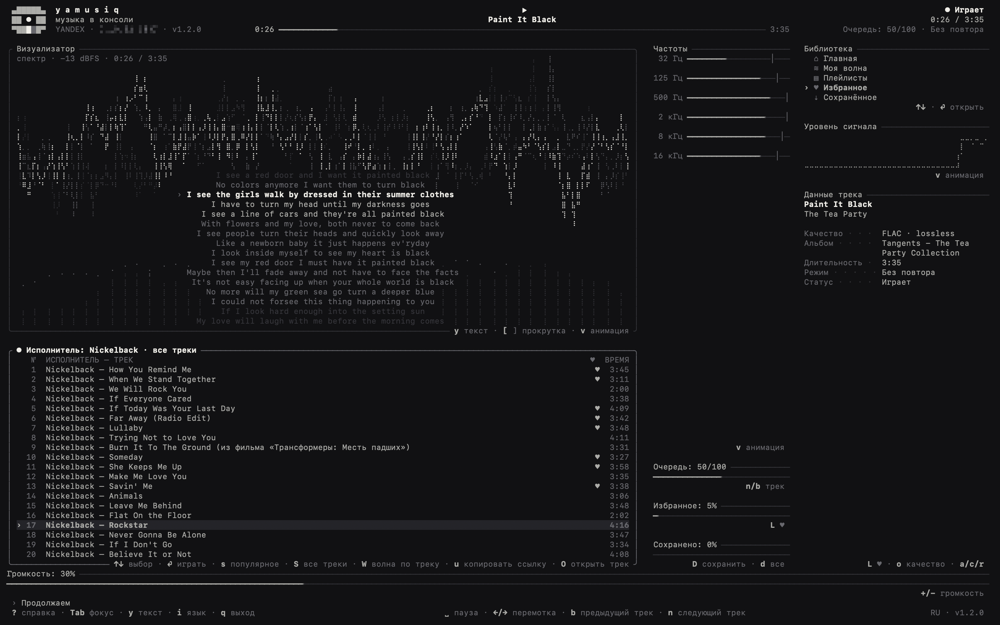

# yamusiq

[English](README.en.md) · **Версия 1.2.0**



Клиент Яндекс Музыки для терминала с управлением с клавиатуры. Rust и ratatui,
macOS на Apple Silicon и Intel.

## Возможности

Полноэкранный плеер для вашего аккаунта Яндекс Музыки: поиск, плейлисты, «Моя
волна», лайки (просмотр, лайк, снятие лайка), страницы исполнителя (популярное и
все треки), текст песни (синхронизированный LRC или обычный) и воспроизведение в
выбранном качестве вплоть до FLAC без потерь. Демо-режима нет: при первом запуске
yamusiq проводит вас через вход в аккаунт.

Карта исходников:

- `src/service.rs` — трейт `MusicService` (поиск, плейлисты, волна, лайки, скачанное, треки исполнителя, лайк/анлайк, тексты, ссылка на поток);
- `src/login.rs` — вход при первом запуске: инструкция, открытие страницы входа Яндекса, приём ключа или всей ссылки из адресной строки без отображения на экране, проверка и сохранение с правами 600;
- `src/yandex/` — `YandexService` для `api.music.yandex.net`. Это неофициальный API, которым пользуются официальные приложения. Включает подпись запросов для текстов и прямых ссылок на поток;
- `src/player.rs` — трейт `Player` (play, pause, seek, анализ) и `SimPlayer`, плеер только по часам, для тестов и машин без аудиоустройства;
- `src/audio/` — `AudioPlayer`: FFmpeg декодирует поток в PCM, cpal выводит звук, а колбэк вывода снимает то, что реально доходит до динамиков. FFT с окном Ханна и дополнением нулями превращает это в 48 логарифмических полос, уровень и триггерную осциллограмму;
- `src/model.rs` — треки, плейлисты и тексты песен, включая разбор LRC (`[mm:ss.xx] строка`) с откатом на обычный текст;
- `src/app.rs` — состояние, обработка клавиш, очередь, режимы без повтора / повтор трека / повтор плейлиста / случайный порядок, следование за текстом и ручная прокрутка;
- `src/net.rs` — шесть независимых очередей: воспроизведение, каталог, Волна, тексты, действия и загрузки; устаревшие запросы чтения пропускаются, пакетные загрузки поддерживают отмену;
- `src/timing.rs` — необязательная диагностика задержек: только названия этапов и длительности;
- `src/radio.rs` — пачки рекомендаций, события feedback и ID исходной пачки для каждого трека;
- `src/links.rs` — публичные ссылки на треки, разбор ID и буфер обмена macOS;
- `src/likes.rs` — метаданные страниц избранного и стабильные упорядоченные списки ID;
- `src/i18n.rs` — русский (по умолчанию) и английский интерфейс, русские числительные, отображение ЙЦУКЕН → QWERTY;
- `src/ui/` — отрисовка: `mod.rs` (раскладка и панели), `visualizer.rs` (визуализатор и оверлей текста), `parts.rs` (шапка, полосы, индикаторы, карточка);
- `src/testing/` — поддельный каталог в памяти с оригинальными текстами, компилируется только для тестов.

Пока поток загружается, визуализатор пишет `буферизация`, а когда ничего не
играет — `нет сигнала`. Текст песни прокручивается по центру визуализатора:
строки выровнены по середине, текущая строка находится на центральной горизонтали. Каждая строка ложится на фон только под своими
глифами, поэтому сцена просвечивает между строк.
Если текст загружается или отсутствует, по центру визуализатора показывается
название трека. При ручном скрытии через `y` визуализатор остаётся без текста.
В шапке между логотипом и правой сводкой всегда виден текущий трек в три строки:
значок воспроизведения/паузы, название, затем текущая позиция, компактная полоса
прогресса и длительность. Длинное название обрезается многоточием. Нижний блок
«Прогресс трека» удалён. Подсказки воспроизведения находятся по центру нижней строки
с отступами по три символа от соседних групп; в узком окне — на отдельной строке.
Синхронизированный (LRC) текст следует за метками времени. Обычный текст
распределяется по длине трека. `[` / `]` прокручивают вручную, а через 6 с после
последней прокрутки вид возвращается к следованию за воспроизведением.

Потоки берутся из `/get-file-info` (эндпоинт десктопного приложения, незашифрованный
транспорт `raw`), с откатом на устаревший MP3 `download-info`. В карточке трека
показывается то качество, которое вы реально слышите.

Сетевые запросы выполняются в фоне: интерфейс продолжает работать во время
загрузки списков, потоков и текстов. Избранное подгружается по 100 песен без
ограничения в 300 треков. Новые сессии сохраняют страницы и курсоры; при
восстановлении старой сессии без метаданных пагинации список обновляется.

«Моя волна» подкачивает новые пачки по мере исчерпания очереди, а не зацикливает
первую. Feedback сообщает о начале, завершении и пропуске треков; лайки
по-прежнему отправляются через API избранного.

## Запуск

```sh
cargo run --release    # открыть плеер (первый запуск: вход)
cargo run -- --login   # войти заново / сменить аккаунт, затем открыть плеер
cargo run -- --logout  # забыть сохранённый ключ
cargo run -- --help    # все ключи командной строки
```

Ключи командной строки:

| Ключ | Что делает |
| --- | --- |
| `--download-all` / `--dont-download-all` | Включить/выключить (и запомнить) режим, при котором каждый начатый трек ещё и сохраняется на диск; виден как `⇣ авто` в футере |
| `--download-fav` | Синхронизировать избранное без интерфейса: скачать все лайкнутые треки, которых ещё нет, с индикатором прогресса и завершиться (Ctrl-C останавливает; недокачанные файлы удаляются при следующем запуске) |
| `--download-to-music` | Собрать просматриваемую копию сохранённых треков в `~/Music/yamusiq` (`<Исполнитель>/<Исполнитель> — <Название>`). Используются жёсткие ссылки, так что места не занимает; повторные запуски добавляют только новое |
| `--remove-all-downloaded` | Удалить всё сохранённое после подтверждения; добавьте `--yes` для скриптов |

Требования: `ffmpeg` в `PATH` (`brew install ffmpeg`) для воспроизведения.

### Вход

yamusiq нужен ключ доступа к Яндекс Музыке (OAuth-токен). При первом запуске
или когда сохранённый ключ перестаёт работать, он спрашивает ключ до открытия
плеера:

1. Предлагает открыть страницу входа Яндекса для приложения Яндекс Музыки: <https://oauth.yandex.ru/authorize?response_type=token&client_id=23cabbbdc6cd418abb4b39c32c41195d>.
2. После входа браузер оказывается на `https://music.yandex.ru/#access_token=…&token_type=bearer…`.
3. Вставьте этот адрес целиком или только ключ после `access_token=`. Ввод не отображается. yamusiq извлекает ключ и проверяет его в Яндексе.
4. Сохраняет ключ в `~/.config/yamusiq/token`, читаемый только вами. Ключи живут около года; когда истечёт, вас спросят снова.

`YAMUSIQ_TOKEN` перекрывает сохранённый ключ. Ключ никогда не печатается и не
пишется в логи. Без терминала, где можно спросить (например, в скриптах),
yamusiq пишет, где взять ключ, и завершается.

Управление:

| Клавиша | Действие |
| --- | --- |
| `f` | поиск (введите, `Enter` — запуск, `Esc` — отмена) |
| `p` / `w` / `l` / `d` | плейлисты / моя волна / лайки / сохранённое (локальная медиатека) |
| `W` | запустить Волну по выделенному треку (вне списка — по играющему) |
| `u` | скопировать публичную ссылку на трек в буфер обмена macOS |
| `O` (Shift+o) | модальное окно: вставить ссылку или ID, `Enter` — открыть и играть, `Esc` — отменить |
| `s` / `S` | исполнитель выделенного трека (если песни в списке не выбрано — играющего): популярное / все треки |
| `o` | качество потока: best (FLAC без потерь) → high (AAC 256) → normal (AAC 192) → data saver (HE-AAC 64); применяется сразу и запоминается |
| `j` `k` / `↑` `↓`, `Tab`, `Enter` | перемещение, смена фокуса, открыть / играть |
| `Space`, `n`, `b` | пауза-воспроизведение, следующий, предыдущий |
| `←` / `→` | перемотка −5 с / +5 с |
| `y` | показать / скрыть текст |
| `[` / `]` | ручная прокрутка текста |
| `L` | лайк / снять лайк выделенному треку; играющему — только если нет выделенной строки с треком |
| `D` | сохранить трек в локальную медиатеку; нажать снова — удалить сохранённый файл |
| `⌥⇧D` | синхронизировать всё избранное в медиатеку (снова — остановить); индикатор прогресса в нижней строке |
| `a` | без повтора: остановиться в конце очереди |
| `c` | переключить: без повтора → зациклить трек → повтор плейлиста (всей очереди) |
| `r` | случайный порядок |
| `Shift+←` | из плейлиста к списку плейлистов; от исполнителя, открытого из Избранного, — обратно в Избранное, сохраняя выделение и воспроизведение |
| `+` `-`, `v` | громкость, движение визуализатора вкл/выкл |
| `i` | язык интерфейса RU ↔ EN |
| `?` / `h` / `F1` | оверлей справки |
| `q` / `Esc` / `Ctrl-C` | выход |

Повтор плейлиста зацикливает всю очередь воспроизведения, включая Избранное
и результаты поиска. Ручные команды «следующий/предыдущий» переключают песни
и при зацикленном треке.

Горячие клавиши работают и при активной русской раскладке (например, `а` = `f`,
`ц` = `w`, `х` = `[`); ввод в поиске принимается как есть, без учёта регистра,
с «ё» = «е».

`Shift+L` во всех списках меняет сердечко выделенного трека; играющий трек
используется только при отсутствии выделенной строки с треком. В Избранном это работает без удаления строки,
перезагрузки списка и сброса выделения. Список обновляется при явном повторном
открытии Избранного. Если запрос завершился ошибкой, сердечко возвращается на месте.

Локальная медиатека: `D` сохраняет трек как аудиофайл с тегами в
`~/Library/yamusiq/<Исполнитель>/<Исполнитель> — <Название>.<ext>`. Намеренно вне
`~/Music`; `YAMUSIQ_LIBRARY` меняет расположение. Медиатека прежних версий из
`~/Music/yamusiq` переносится туда при первом запуске. Файл сохраняется в
выбранном качестве и пересобирается контейнером без перекодирования, поэтому FLAC
остаётся бит-в-бит. Сохранённые треки помечаются `⇣` рядом с названием, появляются
в разделе «Сохранённое» (`d`) и играют с диска — мгновенно и офлайн. Индекс —
`library.json` в папке медиатеки. Без потерь избранное весит в среднем около
25 МБ на трек, так что прикиньте размер перед полной синхронизацией большого
списка «Мне нравится».

Пока работает, yamusiq задаёт заголовок окна «yamusiq · музыка в консоли» (или
«yamusiq · music in the console» на английском) и на выходе возвращает прежний.
FFmpeg запускается как сиротский процесс: он не является потомком yamusiq и не
имеет управляющего терминала, поэтому Terminal не показывает его («yamusiq ▸
ffmpeg»). yamusiq останавливает его сам. Terminal.app всё равно добавляет рабочую
папку, имя процесса и размер окна. Чтобы это отключить, откройте Settings →
Profiles → Window (и Tab) → Title и снимите «Working directory or document»,
«Active process name» и «Dimensions».

`⌥⇧D` приходит как Alt+Shift+D, если терминал передаёт Option как Meta (iTerm2:
Profiles → Keys → «Option key: Esc+»). Без Meta macOS присылает `Î` на
американской раскладке; yamusiq принимает и это.

На выходе yamusiq сохраняет сессию в `~/.config/yamusiq/session.json`: открытый
список с его треками, курсор, очередь, текущий трек и его позицию, режим
воспроизведения и громкость. При следующем запуске тот же аккаунт продолжает
оттуда. Трек открывается на паузе на той же секунде со свежей ссылкой на поток,
`Space` запускает.

Язык и качество потока сохраняются на выходе в `~/.config/yamusiq/config.json`
(или `$XDG_CONFIG_HOME/yamusiq/config.json`); `YAMUSIQ_LANG=ru|en` перекрывает.
Интерфейс стартует на русском.

Цвета 24-битные: нужен терминал с truecolor (iTerm2, Ghostty, WezTerm, Kitty,
Alacritty). При входе в плеер yamusiq задаёт фону терминала тот же цвет
`#111113` через OSC 11: в поддерживающих терминалах внутренние поля окна
сливаются с интерфейсом без изменения отступов содержимого. При выходе или
панике фон сбрасывается к цвету профиля через OSC 111. Поддержка зависит от
терминала; если поля остаются другого цвета, задайте в профиле фон `#111113`
вручную. В стандартном Terminal.app на macOS Tahoe автоматическая смена фона
полей не работает: цвет фона профиля нужно установить вручную в RGB **17, 17, 19**
с непрозрачностью 100%.

Тесты: `cargo test --locked`; проверки стиля: `cargo clippy --locked --all-targets -- -D warnings`.
Живые проверки API не входят в обычный запуск тестов и требуют отдельного осознанного запуска. Текстовый дамп отрисованного экрана: `cargo test dump_screen -- --ignored --nocapture` (`YAMUSIQ_DUMP_AT=<секунды>` задаёт позицию воспроизведения).

## Установка

Для воспроизведения нужен FFmpeg:

```sh
brew install ffmpeg
```

После публикации 1.2.0 на crates.io можно установить плеер из исходников
(нужен Rust с поддержкой edition 2024):

```sh
cargo install yamusiq --version 1.2.0 --locked
```


Скачайте архив под ваш Mac и положите бинарник в `PATH`:

```sh
curl -fsSL https://raw.githubusercontent.com/razil3/yamusiq/master/scripts/install.sh | sh
```

Скрипт выбирает `arm64` или `x86_64`, сверяет архив с `SHA256SUMS` и ставит
бинарник в `/usr/local/bin`, а если туда нет прав — в `~/.local/bin`.
Закрепить опубликованный релиз можно через `YAMUSIQ_VERSION=vX.Y.Z`. Для воспроизведения
по-прежнему нужен `ffmpeg`.

## Постраничная загрузка Избранного

При открытии Избранного один раз получается небольшой полный список ID,
а подробные данные загружаются только для первых **100 песен**. Когда выделение
или воспроизведение доходит до **90-й песни**, в фоне запрашиваются следующие
100; затем пороги — 190, 290 и так далее. Страницы дописываются в конец без
сброса выделения, воспроизведения и сердечек уже показанных строк. Заголовок
показывает число загруженных строк и общее количество: **загружено 100/4179**.
Недоступные треки пропускаются, поэтому в странице может быть меньше 100
проигрываемых песен; курсор всё равно учитывает все обработанные ID.

Если следующая страница задержалась, плеер ждёт её, а не останавливается и не
зацикливает загруженную часть. Подкачка очереди Избранного продолжается и при
просмотре другого раздела. Повторное открытие Избранного получает новый список
ID, не заменяя уже играющую очередь. Страницы и оба курсора сохраняются в
сессии. Полная синхронизация (`⌥⇧D` / `--download-fav`) по-прежнему обрабатывает
**всё** Избранное независимо от страниц интерфейса.

Новые действия (`W`, `u`, `O`) находятся на нижней линии рамки списка вместе
с навигацией. На узких панелях подписи сокращаются; полное описание есть в F1.

## Волна и обмен треками

`w` загружает «Мою волну»; выберите трек и нажмите `Enter` для воспроизведения.
`W` сразу запускает станцию по выделенному треку. Первая пачка показывается
и доступна для воспроизведения сразу после ответа сервиса; затем оба списка
добираются до **15 уникальных треков** в фоне, не задерживая запуск музыки.
При переходе выделения на предпоследнюю строку запрашиваются **ещё пять**;
курсор и текущее воспроизведение не меняются. Подкачка по ходу прослушивания
тоже сохраняется: когда впереди остаётся три трека или меньше. Порядок
рекомендаций сохраняется. Если Яндекс повторяет пачку или не отдаёт достаточно
новых песен, показываются доступные: число попыток ограничено, дубли удаляются,
прокрутка не отправляет фиктивных событий прослушивания или пропуска. Зацикливание трека работает; повтор плейлиста и случайный порядок
не зацикливают и не перемешивают очередь Волны. При пустой пачке или ошибке
доигрываются уже загруженные треки, затем плеер ждёт новые, повторяя запрос
через 10 секунд. Переход между разделами не останавливает Волну; запуск трека
из другого списка или открытие присланного трека заменяет очередь Волны.

`u` и `O` — отдельные функции обмена треками, а не управление Волной.
В списке копируется ссылка на выделенный трек, вне списка — на играющий.
Модальное окно принимает числовой ID, `trackId:albumId` или публичную ссылку
Яндекс Музыки: `https://music.yandex.ru/album/ALBUM/track/TRACK` либо
`https://music.yandex.ru/track/TRACK`. Вставка не выполняет команды и не
загружает произвольные URL. До нахождения нового трека текущая музыка
продолжает играть. После успешного поиска запускается очередь из одного трека.

## Диагностика задержек

У воспроизведения своя очередь: оно не ждёт загрузки каталога, текстов,
feedback Волны и скачиваний. Устаревшие запросы чтения пропускаются до запуска;
пакетные загрузки избранного, страниц исполнителя и рекомендаций проверяют
отмену между запросами. Уже выполняющийся HTTP-запрос ограничен прежним
таймаутом. Запросы Волны и feedback выполняются по порядку в одной очереди;
изменения лайков — последовательно в очереди действий.

Для записи измерений в файл, без вывода поверх интерфейса:

```sh
YAMUSIQ_TIMINGS="$HOME/Library/Logs/yamusiq-timings.log" ./dist/yamusiq-1.2.0-universal
```

Записываются ожидание в очереди (`playback.queue`, `catalogue.queue` и др.),
длительность запроса (`playback.request` и др.), время до передачи источника
плееру (`playback.ready`) и запуск декодера до первых PCM-сэмплов в буфере
(`audio.first_pcm`). Только названия этапов и миллисекунды — без ID треков,
имени аккаунта, URL и токенов. Без этой переменной файл не создаётся.
Это отдельные этапы, а не сквозной замер до появления слышимого звука.

## Платформа

macOS на Apple Silicon и Intel (CoreAudio через cpal). Для релизов собираются
arm64, x86_64 и Universal-бинарники. Для воспроизведения нужен FFmpeg.
