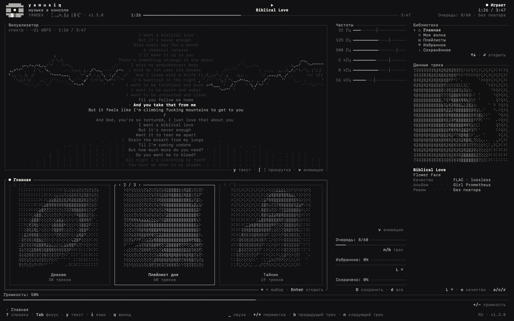

# yamusiq

[](https://github.com/razil3/yamusiq/releases/latest)
[](https://github.com/razil3/yamusiq/releases/latest)
[](https://www.rust-lang.org/)
[](https://crates.io/crates/yamusiq)

[English](README.en.md) · **Версия 1.3.0**

Клиент Яндекс Музыки для терминала с управлением с клавиатуры. macOS на Apple Silicon и Intel.



## Быстрая установка

Нужны macOS 11.0 или новее (Apple Silicon / Intel) и FFmpeg для воспроизведения.

```sh
brew install ffmpeg
curl -fsSL https://raw.githubusercontent.com/razil3/yamusiq/master/scripts/install.sh | sh
yamusiq
```

При первом запуске yamusiq проводит вас через вход в аккаунт.

Установщик выбирает архитектуру Mac, сверяет архив с `SHA256SUMS` и проверяет
подпись `.app`. Приложение устанавливается в `~/Applications/yamusiq.app`,
а команда `yamusiq` — в `/usr/local/bin`, если каталог доступен для записи,
иначе в `~/.local/bin`. Если команда не найдена, добавьте каталог в `PATH`:

```sh
export PATH="$HOME/.local/bin:$PATH"
```

Команда запускает плеер в текущем терминале. Двойной клик по `.app` открывает
Terminal с плеером; отдельной иконки yamusiq в Dock нет. Сохраняйте bundle
целиком — он нужен для собственной иконки в системной панели воспроизведения.
Повторный запуск установщика обновляет приложение. Каталоги можно изменить через
`YAMUSIQ_APP_DIR` и `YAMUSIQ_BIN_DIR`, версию — через `YAMUSIQ_VERSION=vX.Y.Z`.
Подпись локальная (ad-hoc), без нотариализации Apple. При установке через `curl`
ручная подпись обычно не нужна; для скачанного браузером приложения Gatekeeper
может потребовать разрешение на запуск.

## Запуск и управление

```sh
yamusiq             # открыть плеер
yamusiq --login     # войти заново / сменить аккаунт
yamusiq --logout    # забыть сохранённый ключ
yamusiq --help      # все ключи командной строки
```

Ключи командной строки:

| Ключ | Что делает |
| --- | --- |
| `--download-all` / `--dont-download-all` | Включить/выключить (и запомнить) режим, при котором каждый начатый трек ещё и сохраняется на диск; виден как `⇣ авто` в футере |
| `--download-fav` | Синхронизировать избранное без интерфейса: скачать все лайкнутые треки, которых ещё нет, с индикатором прогресса и завершиться (Ctrl-C останавливает; недокачанные файлы удаляются при следующем запуске) |
| `--download-to-music` | Собрать просматриваемую копию сохранённых треков в `~/Music/yamusiq` (`<Исполнитель>/<Исполнитель> — <Название>`). Используются жёсткие ссылки, так что места не занимает; повторные запуски добавляют только новое |
| `--remove-all-downloaded` | Удалить всё сохранённое после подтверждения; добавьте `--yes` для скриптов |

Требования: `ffmpeg` в `PATH` (`brew install ffmpeg`) для воспроизведения.

### Вход

yamusiq нужен ключ доступа к Яндекс Музыке (OAuth-токен). При первом запуске
или когда сохранённый ключ перестаёт работать, он спрашивает ключ до открытия
плеера:

1. Предлагает открыть страницу входа Яндекса для приложения Яндекс Музыки: <https://oauth.yandex.ru/authorize?response_type=token&client_id=23cabbbdc6cd418abb4b39c32c41195d>.
2. После входа браузер оказывается на `https://music.yandex.ru/#access_token=…&token_type=bearer…`.
3. Вставьте этот адрес целиком или только ключ после `access_token=`. Ввод не отображается. yamusiq извлекает ключ и проверяет его в Яндексе.
4. Сохраняет ключ в `~/.config/yamusiq/token`, читаемый только вами. Ключи живут около года; когда истечёт, вас спросят снова.

`YAMUSIQ_TOKEN` перекрывает сохранённый ключ. Ключ никогда не печатается и не
пишется в логи. Без терминала, где можно спросить (например, в скриптах),
yamusiq пишет, где взять ключ, и завершается.

Управление:

| Клавиша | Действие |
| --- | --- |
| `f` | поиск (введите, `Enter` — запуск, `Esc` — отмена) |
| `p` / `w` / `l` / `d` | плейлисты / моя волна / лайки / сохранённое (локальная медиатека) |
| `W` | запустить Волну по выделенному треку (вне списка — по играющему) |
| `u` | скопировать публичную ссылку на трек в буфер обмена macOS |
| `O` (Shift+o) | модальное окно: вставить ссылку или ID, `Enter` — открыть и играть, `Esc` — отменить |
| `s` / `S` | исполнитель выделенного трека (если песни в списке не выбрано — играющего): популярное / все треки |
| `o` | качество потока: best (FLAC без потерь) → high (AAC 256) → normal (AAC 192) → data saver (HE-AAC 64); применяется сразу и запоминается |
| `j` `k` / `↑` `↓`, `Tab`, `Enter` | перемещение, смена фокуса, открыть / играть |
| `Space`, `n`, `b` | пауза-воспроизведение, следующий, предыдущий |
| `←` / `→` | на Главной в фокусе карточек — выбрать «Дежавю» / «Плейлист дня» / «Тайник»; иначе перемотка −5 с / +5 с |
| `y` | показать / скрыть текст |
| `[` / `]` | ручная прокрутка текста |
| `L` | лайк / снять лайк выделенному треку; играющему — только если нет выделенной строки с треком |
| `D` | сохранить трек в локальную медиатеку; нажать снова — удалить сохранённый файл |
| `⌥⇧D` | синхронизировать всё избранное в медиатеку (снова — остановить); индикатор прогресса в нижней строке |
| `a` | без повтора: остановиться в конце очереди |
| `c` | переключить: без повтора → зациклить трек → повтор плейлиста (всей очереди) |
| `r` | случайный порядок |
| `Shift+←` | из плейлиста к карточкам Главной или списку плейлистов, откуда он открыт; от исполнителя, открытого из Избранного, — обратно в Избранное, сохраняя выделение и воспроизведение |
| `+` `-`, `v` | громкость, движение визуализатора вкл/выкл |
| `i` | язык интерфейса RU ↔ EN |
| `?` / `h` / `F1` | оверлей справки |
| `q` / `Esc` / `Ctrl-C` | выход |

Повтор плейлиста зацикливает всю очередь воспроизведения, включая Избранное
и результаты поиска. Ручные команды «следующий/предыдущий» переключают песни
и при зацикленном треке.

Горячие клавиши работают и при активной русской раскладке (например, `а` = `f`,
`ц` = `w`, `х` = `[`); ввод в поиске принимается как есть, без учёта регистра,
с «ё» = «е».

`Shift+L` во всех списках меняет сердечко выделенного трека; играющий трек
используется только при отсутствии выделенной строки с треком. В Избранном это работает без удаления строки,
перезагрузки списка и сброса выделения. Список обновляется при явном повторном
открытии Избранного. Если запрос завершился ошибкой, сердечко возвращается на месте.

Локальная медиатека: `D` сохраняет трек как аудиофайл с тегами в
`~/Library/yamusiq/<Исполнитель>/<Исполнитель> — <Название>.<ext>`. Намеренно вне
`~/Music`; `YAMUSIQ_LIBRARY` меняет расположение. Медиатека прежних версий из
`~/Music/yamusiq` переносится туда при первом запуске. Файл сохраняется в
выбранном качестве и пересобирается контейнером без перекодирования, поэтому FLAC
остаётся бит-в-бит. Сохранённые треки помечаются `⇣` рядом с названием, появляются
в разделе «Сохранённое» (`d`) и играют с диска — мгновенно и офлайн. Индекс —
`library.json` в папке медиатеки. Без потерь избранное весит в среднем около
25 МБ на трек, так что прикиньте размер перед полной синхронизацией большого
списка «Мне нравится».

Пока работает, yamusiq задаёт заголовок окна «yamusiq · музыка в консоли» (или
«yamusiq · music in the console» на английском) и на выходе возвращает прежний.
FFmpeg запускается как сиротский процесс: он не является потомком yamusiq и не
имеет управляющего терминала, поэтому Terminal не показывает его («yamusiq ▸
ffmpeg»). yamusiq останавливает его сам. Terminal.app всё равно добавляет рабочую
папку, имя процесса и размер окна. Чтобы это отключить, откройте Settings →
Profiles → Window (и Tab) → Title и снимите «Working directory or document»,
«Active process name» и «Dimensions».

`⌥⇧D` приходит как Alt+Shift+D, если терминал передаёт Option как Meta (iTerm2:
Profiles → Keys → «Option key: Esc+»). Без Meta macOS присылает `Î` на
американской раскладке; yamusiq принимает и это.

На выходе yamusiq сохраняет сессию в `~/.config/yamusiq/session.json`: открытый
список с его треками, курсор, очередь, текущий трек и его позицию, режим
воспроизведения и громкость. При следующем запуске тот же аккаунт продолжает
оттуда. Трек открывается на паузе на той же секунде со свежей ссылкой на поток,
`Space` запускает.

Язык и качество потока сохраняются на выходе в `~/.config/yamusiq/config.json`
(или `$XDG_CONFIG_HOME/yamusiq/config.json`); `YAMUSIQ_LANG=ru|en` перекрывает.
Интерфейс стартует на русском.

Цвета 24-битные: нужен терминал с truecolor (iTerm2, Ghostty, WezTerm, Kitty,
Alacritty). При входе в плеер yamusiq задаёт фону терминала тот же цвет
`#111113` через OSC 11: в поддерживающих терминалах внутренние поля окна
сливаются с интерфейсом без изменения отступов содержимого. При выходе или
панике фон сбрасывается к цвету профиля через OSC 111. Поддержка зависит от
терминала; если поля остаются другого цвета, задайте в профиле фон `#111113`
вручную. В стандартном Terminal.app на macOS Tahoe автоматическая смена фона
полей не работает: цвет фона профиля нужно установить вручную в RGB **17, 17, 19**
с непрозрачностью 100%.

## Возможности

Полноэкранный плеер для вашего аккаунта Яндекс Музыки: поиск, плейлисты, «Моя
волна», лайки (просмотр, лайк, снятие лайка), страницы исполнителя (популярное и
все треки), текст песни (синхронизированный LRC или обычный) и воспроизведение в
выбранном качестве вплоть до FLAC без потерь.

На Главной показаны три персональных плейлиста с монохромными обложками и числом треков. `←` / `→` выбирают карточку, `Enter` открывает её треки без автозапуска, `Shift+←` возвращает к прежней карточке. В узком блоке видна одна выбранная карточка; при недостаточной высоте обложка скрывается.

Пока поток загружается, визуализатор пишет `буферизация`, а когда ничего не
играет — `нет сигнала`. Текст песни прокручивается по центру визуализатора:
строки выровнены по середине, текущая строка находится на центральной горизонтали. Каждая строка ложится на фон только под своими
глифами, поэтому сцена просвечивает между строк.
Если текст загружается или отсутствует, по центру визуализатора показывается
название трека. При ручном скрытии через `y` визуализатор остаётся без текста.
В шапке между логотипом и правой сводкой всегда виден текущий трек в три строки:
значок воспроизведения/паузы, название, затем текущая позиция, компактная полоса
прогресса и длительность. Длинное название обрезается многоточием. Подсказки воспроизведения находятся по центру нижней строки
с отступами по три символа от соседних групп; в узком окне — на отдельной строке.
Синхронизированный (LRC) текст следует за метками времени. Обычный текст
распределяется по длине трека. `[` / `]` прокручивают вручную, а через 6 с после
последней прокрутки вид возвращается к следованию за воспроизведением.

Потоки берутся из `/get-file-info` (эндпоинт десктопного приложения, незашифрованный
транспорт `raw`), с откатом на устаревший MP3 `download-info`. В карточке трека
показывается то качество, которое вы реально слышите.

Обложка в «Данных трека» отображается монохромными символами Braille; название и
метаданные находятся под ней. Длинные названия переносятся. Версия приложения
отображается только внизу справа.

### Системное управление macOS

- Play / Pause, предыдущий и следующий трек, перемотка через системные медиакнопки и Touch Bar.
- Название, исполнитель, альбом, обложка и прогресс трека в «Исполняется».
- Запуск в текущем терминале командой `yamusiq` или в Terminal двойным кликом по `.app`.
- При запуске через `.app` окно разворачивается на рабочую область экрана, без полноэкранного режима.
- Иконка приложения в системных медиапанелях, без отдельной иконки в Dock.

## Сборка из исходников

Нужен Rust с поддержкой edition 2024 и FFmpeg в `PATH`:

```sh
git clone https://github.com/razil3/yamusiq.git
cd yamusiq
cargo run --release --locked
```

После публикации 1.3.0 на crates.io доступна установка через Cargo:

```sh
cargo install yamusiq --version 1.3.0 --locked
```

При `cargo run` и обычном `cargo install` медиакнопки и перемотка работают, но
для собственной системной иконки нужна упаковка:

```sh
cargo build --release --locked
sh scripts/bundle.sh target/release/yamusiq dist/yamusiq.app
./dist/yamusiq.app/Contents/MacOS/yamusiq
# либо: open dist/yamusiq.app
```

Минимальная целевая система — macOS 11.0 для обеих архитектур. Значение хранится
в `.cargo/config.toml`; упаковка проверяет его совпадение с `LSMinimumSystemVersion`
и заголовком Mach-O каждого среза. Это проверка совместимости сборки, не замена
проверке плеера на физическом Mac с macOS 11.

Каталог вывода `bundle.sh` должен быть новым. Локальная сборка и release CI
используют один путь: `dist.sh` → `pack.sh` → `bundle.sh`. Каждый архив содержит
`yamusiq.app` и консольный launcher `yamusiq`; из распакованного архива запускайте
`./yamusiq`, сохраняя `.app` рядом.

```sh
# Проверить native .app и архив во временном каталоге, без входа и музыки:
sh scripts/dist.sh --smoke-test
# Все три архива (нужны оба Rust target); существующие артефакты не перезаписываются:
sh scripts/dist.sh --output dist/release-check
# Отдельно проверить bundle, включая безопасный запуск --version:
sh scripts/test-bundle.sh dist/yamusiq.app arm64 --run
```

Для полной сборки нужны targets `aarch64-apple-darwin` и `x86_64-apple-darwin`
(`rustup target add aarch64-apple-darwin x86_64-apple-darwin`). На Apple Silicon
Intel-bundle проходит статическую проверку без запуска и без требования Rosetta;
arm64 и universal дополнительно запускаются с `--version`. После упаковки каждый
архив распаковывается заново: проверяются plist, архитектуры, минимальная macOS,
актуальность ресурсов, execute bits, подпись всех срезов и консольный launcher.
`SHA256SUMS` проверяется автоматически. Ничего из этих скриптов не публикует релиз.

Workflow `bundle-smoke.yml` проверяет PR и `master`: тесты Rust, раскладку окна,
native-архив и отклонение намеренно повреждённых bundle. `release.yml` запускается
по тегу `v*`, требует совпадения тега с Cargo-версией и публикует только успешно
проверенные архивы arm64, x86_64 и universal. Release notes остаются пустыми для
ручного заполнения.

Тесты: `cargo test --locked`; проверки стиля: `cargo clippy --locked --all-targets -- -D warnings`.
Живые проверки API не входят в обычный запуск тестов и требуют отдельного осознанного запуска. Текстовый дамп отрисованного экрана: `cargo test dump_screen -- --ignored --nocapture` (`YAMUSIQ_DUMP_AT=<секунды>` задаёт позицию воспроизведения).

## Карта исходников

- `src/service.rs` — трейт `MusicService` (поиск, плейлисты, волна, лайки, скачанное, треки исполнителя, лайк/анлайк, тексты, ссылка на поток);
- `src/login.rs` — вход при первом запуске: инструкция, открытие страницы входа Яндекса, приём ключа или всей ссылки из адресной строки без отображения на экране, проверка и сохранение с правами 600;
- `src/yandex/` — `YandexService` для `api.music.yandex.net`. Это неофициальный API, которым пользуются официальные приложения. Включает подпись запросов для текстов и прямых ссылок на поток;
- `src/player.rs` — трейт `Player` (play, pause, seek, анализ) и `SimPlayer`, плеер только по часам, для тестов и машин без аудиоустройства;
- `src/audio/` — `AudioPlayer`: FFmpeg декодирует поток в PCM, cpal выводит звук, а колбэк вывода снимает то, что реально доходит до динамиков. FFT с окном Ханна и дополнением нулями превращает это в 48 логарифмических полос, уровень и триггерную осциллограмму;
- `src/model.rs` — треки, плейлисты и тексты песен, включая разбор LRC (`[mm:ss.xx] строка`) с откатом на обычный текст;
- `src/app.rs` — состояние, обработка клавиш, очередь, режимы без повтора / повтор трека / повтор плейлиста / случайный порядок, следование за текстом и ручная прокрутка;
- `src/net.rs` — шесть независимых очередей: воспроизведение, каталог, Волна, тексты, действия и загрузки; устаревшие запросы чтения пропускаются, пакетные загрузки поддерживают отмену;
- `src/timing.rs` — необязательная диагностика задержек: только названия этапов и длительности;
- `src/home.rs` — персональные подборки Главной: «Дежавю», «Плейлист дня», «Тайник»;
- `src/radio.rs` — пачки рекомендаций, события feedback и ID исходной пачки для каждого трека;
- `src/media.rs`, `src/media/macos.rs` — системные медиакоманды macOS и метаданные Now Playing;
- `src/links.rs` — публичные ссылки на треки, разбор ID и буфер обмена macOS;
- `src/likes.rs` — метаданные страниц избранного и стабильные упорядоченные списки ID;
- `src/i18n.rs` — русский (по умолчанию) и английский интерфейс, русские числительные, отображение ЙЦУКЕН → QWERTY;
- `src/ui/` — отрисовка: `mod.rs` (раскладка и панели), `visualizer.rs` (визуализатор и оверлей текста), `parts.rs` (шапка, полосы, индикаторы, карточка), `home.rs` (карточки Главной);
- `src/testing/` — поддельный каталог в памяти с оригинальными текстами, компилируется только для тестов.
