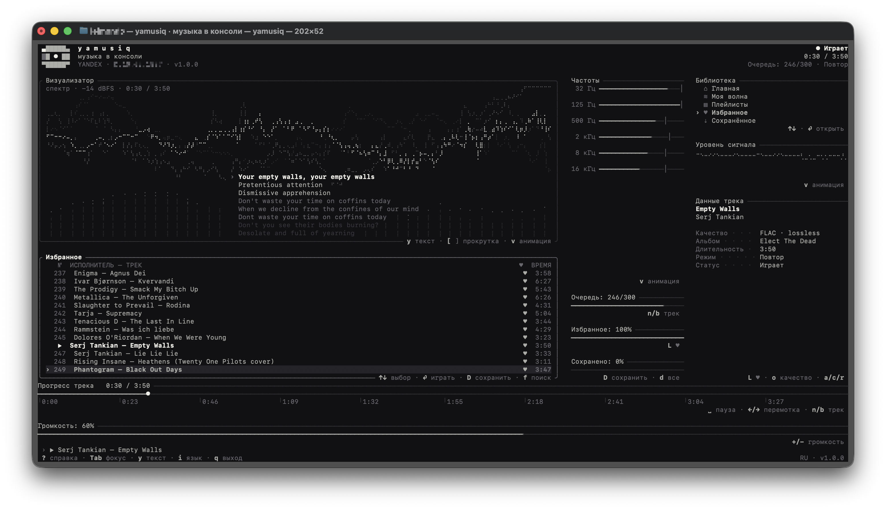

# yamusiq

English version: [README.md](README.md).



Клиент Яндекс Музыки для терминала с управлением с клавиатуры. Rust и ratatui,
macOS на Apple Silicon и Intel.

## Что уже есть

Полноэкранный плеер для вашего аккаунта Яндекс Музыки: поиск, плейлисты, «Моя
волна», лайки (просмотр, лайк, снятие лайка), страницы исполнителя (популярное и
все треки), текст песни (синхронизированный LRC или обычный) и воспроизведение в
выбранном качестве вплоть до FLAC без потерь. Демо-режима нет: при первом запуске
yamusiq проводит вас через вход в аккаунт.

Карта исходников:

- `src/service.rs` — трейт `MusicService` (поиск, плейлисты, волна, лайки, скачанное, треки исполнителя, лайк/анлайк, тексты, ссылка на поток);
- `src/login.rs` — вход при первом запуске: инструкция, открытие страницы входа Яндекса, приём ключа или всей ссылки из адресной строки без отображения на экране, проверка и сохранение с правами 600;
- `src/yandex/` — `YandexService` для `api.music.yandex.net`. Это неофициальный API, которым пользуются официальные приложения. Включает подпись запросов для текстов и прямых ссылок на поток;
- `src/player.rs` — трейт `Player` (play, pause, seek, анализ) и `SimPlayer`, плеер только по часам, для тестов и машин без аудиоустройства;
- `src/audio/` — `AudioPlayer`: FFmpeg декодирует поток в PCM, cpal выводит звук, а колбэк вывода снимает то, что реально доходит до динамиков. FFT с окном Ханна и дополнением нулями превращает это в 48 логарифмических полос, уровень и триггерную осциллограмму;
- `src/model.rs` — треки, плейлисты и тексты песен, включая разбор LRC (`[mm:ss.xx] строка`) с откатом на обычный текст;
- `src/app.rs` — состояние, обработка клавиш, очередь и логика ALL / LOOP / RAND, следование за текстом и ручная прокрутка;
- `src/i18n.rs` — русский (по умолчанию) и английский интерфейс, русские числительные, отображение ЙЦУКЕН → QWERTY;
- `src/ui/` — отрисовка: `mod.rs` (раскладка и панели), `visualizer.rs` (визуализатор и оверлей текста), `parts.rs` (шапка, полосы, индикаторы, карточка);
- `src/testing/` — поддельный каталог в памяти с оригинальными текстами, компилируется только для тестов.

Внешний вид: спокойная монохромная «распечатка» на графите. В шапке — знак
yamusiq, полублочная пластинка, обод которой переливается, пока играет музыка,
рядом словоформенный логотип с разрядкой. В рамку взяты только визуализатор и
таблица треков, остальное — открытые разделы с линейкой-заголовком и своими
подсказками по клавишам под ней. Чистый белый зарезервирован за тем,
что живое.

Визуализатор, слой за слоем: силуэт спектра с удержанием пиков у пола, трёхшаговый
фосфорный след осциллограммы и живая осциллограмма. Всё это берётся из того звука,
который вы слышите: спектр, уровень сигнала и триггерная осциллограмма, как на
осциллографе. Ничего не имитируется. Пока поток загружается, визуализатор пишет
`буферизация`, а когда ничего не играет — `нет сигнала`. Если у трека есть текст,
строки поднимаются по одной справа, поверх визуализатора. Каждая строка ложится на
фон только под своими глифами, поэтому сцена просвечивает между строк.
Синхронизированный (LRC) текст следует за метками времени. Обычный текст
распределяется по длине трека. `[` / `]` прокручивают вручную, а через 6 с после
последней прокрутки вид возвращается к следованию за воспроизведением.

Потоки берутся из `/get-file-info` (эндпоинт десктопного приложения, незашифрованный
транспорт `raw`), с откатом на устаревший MP3 `download-info`. В карточке трека
показывается то качество, которое вы реально слышите.

Известные ограничения: сетевые вызовы выполняются в потоке интерфейса, поэтому
экран на короткое время замирает, пока грузится список или поток. «Моя волна»
загружает одну пачку треков.

## Запуск

```sh
cargo run              # открыть плеер (первый запуск: вход)
cargo run -- --login   # войти заново / сменить аккаунт, затем открыть плеер
cargo run -- --logout  # забыть сохранённый ключ
cargo run -- --help    # все ключи командной строки
```

Ключи командной строки:

| Ключ | Что делает |
| --- | --- |
| `--download-all` / `--dont-download-all` | Включить/выключить (и запомнить) режим, при котором каждый начатый трек ещё и сохраняется на диск; виден как `⇣ авто` в футере |
| `--download-fav` | Синхронизировать избранное без интерфейса: скачать все лайкнутые треки, которых ещё нет, с индикатором прогресса и завершиться (Ctrl-C останавливает; недокачанные файлы удаляются при следующем запуске) |
| `--download-to-music` | Собрать просматриваемую копию сохранённых треков в `~/Music/yamusiq` (`<Исполнитель>/<Исполнитель> — <Название>`). Используются жёсткие ссылки, так что места не занимает; повторные запуски добавляют только новое |
| `--remove-all-downloaded` | Удалить всё сохранённое после подтверждения; добавьте `--yes` для скриптов |

Требования: `ffmpeg` в `PATH` (`brew install ffmpeg`) для воспроизведения.

### Вход

yamusiq нужен ключ доступа к Яндекс Музыке (OAuth-токен). При первом запуске
или когда сохранённый ключ перестаёт работать, он спрашивает ключ до открытия
плеера:

1. Предлагает открыть страницу входа Яндекса для приложения Яндекс Музыки: <https://oauth.yandex.ru/authorize?response_type=token&client_id=23cabbbdc6cd418abb4b39c32c41195d>.
2. После входа браузер оказывается на `https://music.yandex.ru/#access_token=…&token_type=bearer…`.
3. Вставьте этот адрес целиком или только ключ после `access_token=`. Ввод не отображается. yamusiq извлекает ключ и проверяет его в Яндексе.
4. Сохраняет ключ в `~/.config/yamusiq/token`, читаемый только вами. Ключи живут около года; когда истечёт, вас спросят снова.

`YAMUSIQ_TOKEN` перекрывает сохранённый ключ. Ключ никогда не печатается и не
пишется в логи. Без терминала, где можно спросить (например, в скриптах),
yamusiq пишет, где взять ключ, и завершается.

Управление:

| Клавиша | Действие |
| --- | --- |
| `f` | поиск (введите, `Enter` — запуск, `Esc` — отмена) |
| `p` / `w` / `l` / `d` | плейлисты / моя волна / лайки / сохранённое (локальная медиатека) |
| `s` / `S` | исполнитель играющего (или выбранного) трека: популярное / все треки |
| `o` | качество потока: best (FLAC без потерь) → high (AAC 256) → normal (AAC 192) → data saver (HE-AAC 64); применяется сразу и запоминается |
| `j` `k` / `↑` `↓`, `Tab`, `Enter` | перемещение, смена фокуса, открыть / играть |
| `Space`, `n`, `b` | пауза-воспроизведение, следующий, предыдущий |
| `←` / `→` | перемотка −5 с / +5 с |
| `y` | показать / скрыть текст |
| `[` / `]` | ручная прокрутка текста |
| `L` | лайк / снять лайк |
| `D` | сохранить трек в локальную медиатеку; нажать снова — удалить сохранённый файл |
| `⌥⇧D` | синхронизировать всё избранное в медиатеку (снова — остановить); индикатор прогресса в нижней строке |
| `a` / `c` / `r` | режим: играть всё / повторять трек / случайный порядок |
| `+` `-`, `v` | громкость, движение визуализатора вкл/выкл |
| `i` | язык интерфейса RU ↔ EN |
| `?` / `h` / `F1` | оверлей справки |
| `q` / `Esc` / `Ctrl-C` | выход |

Горячие клавиши работают и при активной русской раскладке (например, `а` = `f`,
`ц` = `w`, `х` = `[`); ввод в поиске принимается как есть, без учёта регистра,
с «ё» = «е».

Локальная медиатека: `D` сохраняет трек как аудиофайл с тегами в
`~/Library/yamusiq/<Исполнитель>/<Исполнитель> — <Название>.<ext>`. Намеренно вне
`~/Music`; `YAMUSIQ_LIBRARY` меняет расположение. Медиатека прежних версий из
`~/Music/yamusiq` переносится туда при первом запуске. Файл сохраняется в
выбранном качестве и пересобирается контейнером без перекодирования, поэтому FLAC
остаётся бит-в-бит. Сохранённые треки помечаются `⇣` рядом с названием, появляются
в разделе «Сохранённое» (`d`) и играют с диска — мгновенно и офлайн. Индекс —
`library.json` в папке медиатеки. Без потерь избранное весит в среднем около
25 МБ на трек, так что прикиньте размер перед полной синхронизацией большого
списка «Мне нравится».

Пока работает, yamusiq задаёт заголовок окна «yamusiq · музыка в консоли» (или
«yamusiq · music in the console» на английском) и на выходе возвращает прежний.
FFmpeg запускается как сиротский процесс: он не является потомком yamusiq и не
имеет управляющего терминала, поэтому Terminal не показывает его («yamusiq ▸
ffmpeg»). yamusiq останавливает его сам. Terminal.app всё равно добавляет рабочую
папку, имя процесса и размер окна. Чтобы это отключить, откройте Settings →
Profiles → Window (и Tab) → Title и снимите «Working directory or document»,
«Active process name» и «Dimensions».

`⌥⇧D` приходит как Alt+Shift+D, если терминал передаёт Option как Meta (iTerm2:
Profiles → Keys → «Option key: Esc+»). Без Meta macOS присылает `Î` на
американской раскладке; yamusiq принимает и это.

На выходе yamusiq сохраняет сессию в `~/.config/yamusiq/session.json`: открытый
список с его треками, курсор, очередь, текущий трек и его позицию, режим
воспроизведения и громкость. При следующем запуске тот же аккаунт продолжает
оттуда. Трек открывается на паузе на той же секунде со свежей ссылкой на поток,
`Space` запускает.

Язык и качество потока сохраняются на выходе в `~/.config/yamusiq/config.json`
(или `$XDG_CONFIG_HOME/yamusiq/config.json`); `YAMUSIQ_LANG=ru|en` перекрывает.
Интерфейс стартует на русском.

Цвета 24-битные: нужен терминал с truecolor (iTerm2, Ghostty, WezTerm, Kitty,
Alacritty).

Тесты: `cargo test`. Живые проверки API (нужен токен): `cargo test live_ -- --ignored --nocapture`. Текстовый дамп отрисованного экрана: `cargo test dump_screen -- --ignored --nocapture` (`YAMUSIQ_DUMP_AT=<секунды>` задаёт позицию воспроизведения).

Тексты в фикстурах тестов — оригинальные, написанные для вымышленных песен.

## Установка

Скачайте архив под ваш Mac и положите бинарник в `PATH`:

```sh
curl -fsSL https://raw.githubusercontent.com/razil3/yamusiq/master/scripts/install.sh | sh
```

Скрипт выбирает `arm64` или `x86_64`, сверяет архив с `SHA256SUMS` и ставит
бинарник в `/usr/local/bin`, а если туда нет прав — в `~/.local/bin`.
Закрепить релиз можно через `YAMUSIQ_VERSION=v1.0.0`. Для воспроизведения
по-прежнему нужен `ffmpeg`.

## Дальше

`0.2.0` — сетевая работа уходит из потока интерфейса: списки и потоки грузятся в
фоне за состоянием `буферизация`, экран не замирает. `0.2.1` — настоящая «Моя
волна»: пачки подкачиваются по мере исчерпания очереди, воспроизведение
отчитывается станции (начал, закончил, пропустил, лайкнул), и волна идёт вперёд,
а не крутится по одной пачке.

## Платформа

Цель разработки — macOS на Apple Silicon (CoreAudio через cpal). Для
воспроизведения нужен FFmpeg.
